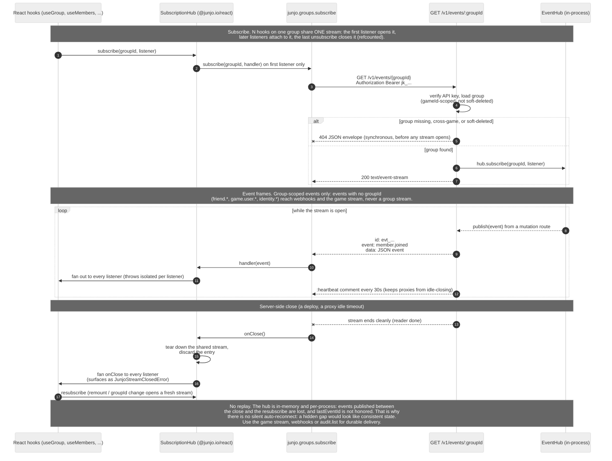

# Events

Junjo emits a `JunjoEvent` whenever state changes: a member joins, a role is assigned, a group is renamed, a player is banned from the game, two ids are linked. Two [Server-Sent Events](https://html.spec.whatwg.org/multipage/server-sent-events.html) streams expose them:

| Stream | Carries | Ordering and resume | Across server instances |
|--------|---------|---------------------|-------------------------|
| [`GET /v1/events`](#get-v1events) (game stream) | Every event of the game, optionally filtered by type | Numbered positions in commit order; resumes after a disconnect from the last position seen | Yes |
| [`GET /v1/events/:groupId`](#get-v1eventsgroupid) (group stream) | The events of one group | Publication order on one instance; no resume | No: one instance's events only |

Use the game stream for anything that must not miss an event (a game server enforcing bans, a cache of the rank setup). Group streams suit live UI for one group.

Both streams render user ids per subscriber (see [User ids in events](#user-ids-in-events)) and share the payload shapes of the `JunjoEvent` union in `@junjo.io/shared`. [Webhooks](/api-reference/webhooks) deliver the same events durably to an HTTP endpoint.

## Event envelope

Every event, on every surface (group streams, the game stream, webhooks and the durable event log), carries these fields next to its type-specific payload:

| Field | Type | Notes |
|-------|------|-------|
| `id` | string | The event's own random identifier, the same on every surface. Use it to deduplicate. |
| `type` | string | The `JunjoEvent` discriminator (`member.joined`, `group.updated`, ...). |
| `gameId` | string | The game the event belongs to. |
| `groupId` | string | Group-scoped events only. See [Events with no group](#events-with-no-group). |
| `occurredAt` | string | ISO 8601 timestamp. |
| `origin` | `{ apiKeyId: string \| null, tag: string \| null }` | Where the write behind the event came from. See [Event origin](#event-origin). |

```json
{
  "id": "5d1e8a2fb34c7a90e6f21b38",
  "type": "group.updated",
  "gameId": "game_xyz",
  "groupId": "grp_qrs",
  "occurredAt": "2026-11-14T12:00:00.000Z",
  "origin": { "apiKeyId": "key_clxxx...", "tag": "sync-eu-1" },
  "group": { "id": "grp_qrs", "name": "Crimson Wolves", "...": "..." },
  "actorUserId": null
}
```

### Event origin

`origin` names the write that caused the event:

| Field | Value |
|-------|-------|
| `apiKeyId` | The `id` of the per-game API key whose request caused the event, as listed by [`GET /v1/admin/games/:gameId/api-keys`](/api-reference/admin#get-v1admingamesgameidapi-keys). `null` for admin-token writes (the dashboard) and for changes Junjo makes on its own, such as expiry and cleanup jobs. |
| `tag` | The request's [`Junjo-Write-Tag`](/api-reference#write-tags) header, exactly as sent, or `null` when the request sent none. |

Every event one request causes carries the same origin. Events logged before the server stamped origins read back with both fields `null`.

A writer that keeps its own copy of the data, and applies its own changes locally when its writes succeed, can use `origin` to skip the events those writes cause:

1. Give each writer a tag of its own (for example, one per server instance) and send it as `Junjo-Write-Tag` on every write.
2. On the stream, skip an event whose `origin.tag` is that tag. To be strict when several keys are in use, also compare `origin.apiKeyId` with the writer's key id.
3. Apply every other event: those come from other writers, from the dashboard, or from Junjo itself.

The tag only labels writes; it is not a credential, and any caller holding a key can send any tag.

## `GET /v1/events`

Opens the game stream: one frame per event of the calling game, in position order. Every event appears, whether or not it belongs to a group.

### Query and headers

| Name | Where | Notes |
|------|-------|-------|
| `types` | query | Optional comma-separated event types, for example `types=game.user.banned,game.user.unbanned`. Only those types are delivered. Same names as a webhook endpoint's `events`; an unknown type is `400 bad_request`. Absent or empty means every type. |
| `Last-Event-ID` | header | Optional stream position to resume after. Absent means start at the game's current position. |
| `Authorization` | header | `Bearer <apiKey>`. Any per-game key may open the stream. |

### Positions

Every event of a game gets a **position**: a decimal number, sent as a string, that grows by one per event in the order the writes committed. Positions are gapless, so a client that saw position 41 and then 43 knows it missed one. They are per game; two games' positions are unrelated. Compare them as 64-bit integers (`BigInt` in JavaScript, `long` in Java), never as floating-point numbers.

The position is not the event's `id`. The JSON `id` is the event's own random identifier, the same one webhooks carry; use it to deduplicate across surfaces. The position is what the `id:` line of a game stream frame carries and what `Last-Event-ID` resumes from.

### Response

`200 OK`, `content-type: text/event-stream`, plus the header `Junjo-Stream-Position`: the position the stream starts after. Event frames:

```
event: game.user.banned
data: {"id":"9f2c41d07a3be1c6d58e0f14","type":"game.user.banned","gameId":"game_xyz","occurredAt":"2026-11-06T12:00:00.000Z","origin":{"apiKeyId":"key_clxxx...","tag":null},"junjoUserId":"...","userId":"mc:2f0c...","reason":"griefing","expiresAt":null}
id: 42

```

Heartbeats every 30 seconds carry the stream's current position, which also moves past events a `types` filter skipped:

```
:heartbeat
id: 57

```

A client should store the last `id:` it saw (from events and heartbeats alike) and send it as `Last-Event-ID` when it reconnects.

### Resuming

- **`Last-Event-ID: P` within retention:** the stream first sends every event after `P` that matches the filter, then live events.
- **`P` too old or unknown:** `410 stream_position_expired`. The log no longer holds every event after `P` (it keeps 24 hours by default), or `P` is ahead of the game. Load a fresh snapshot, then subscribe from that snapshot's position.
- **No `Last-Event-ID`:** live from now. The start position is in the `Junjo-Stream-Position` header.

### Snapshots and the stream

To keep local state (a cache of roles, bans or linked ids) in step with the stream:

1. Read the current position: [`GET /v1/events/position`](#get-v1eventsposition), or the `Junjo-Stream-Position` header of a snapshot read (below). Read the position before the data, or take it from the same response.
2. Load the snapshot.
3. Open the game stream with `Last-Event-ID` set to that position.

The snapshot reflects every event up to the position and possibly a few after it, so the stream may deliver an event the snapshot already shows. Apply events so that applying one twice is harmless: set a value rather than increment it. Most events are change signals or carry the new state, which makes this natural. The opposite order also works: open the stream first (its start position is in the response header), then load the snapshot.

These reads send `Junjo-Stream-Position`, read before their data:

- `GET /v1/groups/:id/role-graph`, `GET /v1/groups/:id/roles`
- `GET /v1/groups/:id/members`, `GET /v1/groups/:id/members/:userId/access`, `POST /v1/groups/:id/members/access`
- `GET /v1/bans`, `GET /v1/sanctions`
- `GET /v1/users/:userId/identities`
- `GET /v1/permissions/config`

### Versions on events

Member and game-ban events carry the version their write produced, so a cache can tell whether it already reflects an event:

| Events | Field | Version |
|--------|-------|---------|
| `member.joined`, `member.left`, `member.updated`, `member.banned`, `member.unbanned`, `role.changed` | `memberVersion` | The member's [version](/api-reference/groups#member-versions) after the write. |
| `game.user.banned`, `game.user.unbanned`, `game.user.sanctioned`, `game.user.unsanctioned` | `moderationVersion` | The person's [moderation version](/api-reference/bans#moderation-version) after the write. |

Group events need no field of their own: on the game stream, the position of an event that names a `groupId` is the [group version](/api-reference/groups#group-versions) that event gave its group. A write that emits several events for one group leaves the group at the position of the last one. Group fields read together with version `V` (from `GET /v1/groups/:id` or an export) reflect at least every change up to position `V`, so a client holding such a read can skip `group.updated` events for that group at positions up to `V`.

A client whose snapshot of the member (or person) shows a version greater than or equal to the event's can skip the event. Every event one write emits carries the same version: an import that creates a member and assigns roles emits `member.joined` and `role.changed` with one `memberVersion`. The `member` inside `member.joined` is the member as that write leaves it, so a client that stores it as its snapshot may skip the rest of that write's events.

### Errors

These fail before the stream opens, with the standard JSON error envelope:

| code | status | when |
|------|--------|------|
| `bad_request` | 400 | Unknown type in `types`, or a `Last-Event-ID` that is not a position. |
| `invalid_api_key` | 401 | API key missing, malformed, or revoked. |
| `stream_position_expired` | 410 | `Last-Event-ID` names a position the log can no longer serve in full. Take a fresh snapshot. |
| `too_many_streams` | 429 | The key already has 10 open game streams, or the game has 200, on the server instance that answered. Close streams you no longer need; retrying in a loop will not help. |

### When the server ends a game stream

The server closes a game stream cleanly when:

- the server shuts down;
- the key is revoked (checked on every heartbeat);
- the client stops reading for 30 seconds;
- the retention sweeper removes events a lagging stream still had to send.

In every case, reconnect with `Last-Event-ID`: the answer is either the missed events or `410`.

### Ordering and delivery guarantees

- An event is written to the event log in the same transaction as the change it describes. A change that rolls back never appears; a change that commits always gets a position.
- Positions follow commit order within a game and are the same on every stream and every server instance.
- Each stream delivers events in position order, and after a resume continues where it left off.
- Server instances share the log through the database. An instance delivers its own writes immediately and picks up other instances' writes within the poll interval (`EVENT_STREAM_POLL_MS`, default 1 second). A single-instance deployment may set it to `0`.
- Retention is `EVENT_LOG_RETENTION_HOURS` (default 24). Events older than that are removed; resuming from before them answers `410`.

## `GET /v1/events/position`

Returns the game's current position:

```json
{ "position": "42" }
```

The same value is in the `Junjo-Stream-Position` header. `"0"` means the game has emitted no events yet.

## `GET /v1/events/:groupId`

Opens the group stream: one frame per `JunjoEvent` published for the named group. A connection covers one group, so subscribing to N groups takes N connections; events for other groups never share a stream. The connection lives until the client disconnects. The server emits a `:heartbeat` comment every 30 seconds so intermediaries do not idle-close the connection.

Group streams are delivered in-process: an in-memory `EventHub` shared by the request handlers of one server process routes each event to that process's subscribers. They have no positions and no resume, and in a multi-instance deployment a group stream only receives events written through its own instance.

### Path parameters

| Field | Required | Notes |
|-------|----------|-------|
| `groupId` | yes | The group to subscribe to. Must belong to the calling game and not be soft-deleted. |

### Headers

| Header | Notes |
|--------|-------|
| `Authorization` | `Bearer <apiKey>`. Required, same as every other authed route. |
| `Accept` | Optional. `text/event-stream` is conventional but the server does not check; the response content-type is fixed to `text/event-stream` regardless. |

### Response

`200 OK` with the standard SSE response headers:

```
content-type: text/event-stream
cache-control: no-cache
connection: keep-alive
transfer-encoding: chunked
```

Frames look like this:

```
event: member.joined
data: {"id":"5d1e8a2fb34c7a90e6f21b38","type":"member.joined","gameId":"game_xyz","groupId":"grp_qrs","occurredAt":"2026-04-28T12:00:00.000Z","origin":{"apiKeyId":"key_clxxx...","tag":null},"userId":"user_alice","member":{...}}
id: 5d1e8a2fb34c7a90e6f21b38

```

Comment-only heartbeat frames (sent every 30 seconds the connection is idle):

```
:heartbeat

```

The `data:` payload is one JSON object per event. The shape is the `JunjoEvent` union from `@junjo.io/shared`. `Date` fields (`occurredAt`, nested `joinedAt`, etc.) serialize as ISO 8601 strings on the wire.

The `event:` line is the `JunjoEvent.type` discriminator (`member.joined`, `member.left`, `group.updated`, ...). The `id:` line of a group stream frame is the event's own `id`. Group streams do not replay missed events on reconnect (see [Limitations](#limitations) below); the [game stream](#get-v1events) does.

### Which mutations publish

The server emits an event after every mutation that changes a group's externally-visible state. These events reach the group's stream and the game stream. The full mapping:

| Route | Event type | Notes |
|-------|------------|-------|
| `PATCH /v1/groups/:id` | `group.updated` | No-op PATCHes (every supplied field already matches) emit nothing. `actorUserId` is the body's `actorUserId`, or `null`. |
| `DELETE /v1/groups/:id` | `group.deleted` | Both soft and hard delete emit the same event. Idempotent calls on already-deleted groups emit nothing. `actorUserId` is the `actorUserId` query parameter, or `null`. |
| `POST /v1/groups/:id/restore` | `group.updated` | Re-emits the post-restore group, with `actorUserId: null`. Restoring a live group emits nothing. |
| `PUT /v1/groups/:id/parent` | `group.updated` | Carries the post-state group with the new `parentGroupId`, with `actorUserId: null`. Idempotent calls (parent unchanged) emit nothing. |
| `POST /v1/groups/:id/invitations` | `member.invited` | One event per created invitation. |
| `POST /v1/groups/:id/bulk-invite` | `member.invited` | One event per created invitation in input order; rows that were skipped (duplicate / already-member / already-pending) emit nothing. |
| `POST /v1/invitations/:code/accept` | `member.joined` | The `member` payload carries the newly-active row. |
| `POST /v1/groups/:id/leave` | `member.left` | `reason: "left"`. Idempotent calls on already-left / already-kicked rows emit nothing. |
| `POST /v1/groups/:id/members/:userId/kick` | `member.left` | `reason: "kicked"`, plus `kickedBy` when the body names an `actorUserId` (absent otherwise). Idempotent calls emit nothing. |
| `POST /v1/groups/:id/members/:userId/ban` | `member.banned` | Carries `userId`, `reason`, `bannedUntil` (null = permanent). Idempotent re-ban with identical expiry emits nothing; changing the expiry re-emits. |
| `DELETE /v1/groups/:id/members/:userId/ban` | `member.unbanned` | Fires on explicit unban. Lazy `bannedUntil` expiry does NOT fire an event; read paths just stop treating the row as banned. Calls on non-banned members 404 (`details.reason: "not_active"`). |
| `POST /v1/groups/:id/members/import` | `member.joined`, `role.changed`, `member.updated` | The events the equivalent single calls emit, for members the import changed; staged in the import's transaction. Unchanged rows emit nothing. |
| `POST /v1/groups/:id/roles` | `role.created` | Carries the post-state role. |
| `DELETE /v1/roles/:id` | `role.deleted`, plus `role.updated` (`changed: ["parents"]`) for each role that inherited from it | |
| `PATCH /v1/groups/:id/members/:userId` | `member.updated` | `changed` lists `"metadata"` and/or `"notes"` (either note). A PATCH that changes nothing emits nothing. Metadata counts as changed whenever it is supplied. |
| `POST /v1/groups/:id/members/:userId/permissions/:permission`, `DELETE` of the same | `member.updated` | `changed: ["overrides"]`: the member's overrides changed. Idempotent calls emit nothing. |
| `PATCH /v1/roles/:id` | `role.updated` | `changed` names the fields that changed. A no-op PATCH emits nothing. |
| `PUT /v1/roles/:id/entries` | `role.updated` | `changed: ["entries"]`. One event per replace, never per-key events. A replace that changes nothing emits nothing. |
| `PUT /v1/roles/:id/parents` | `role.updated` | `changed: ["parents"]`. Unchanged parents emit nothing. |
| `POST /v1/groups/:id/members/:userId/roles/:roleId` | `role.changed` | `added: [roleId]`, `removed: []`. Payload's `actorUserId` is `null` unless the caller supplies `{ actorUserId }` in the body. Idempotent calls (already assigned) emit nothing. |
| `DELETE /v1/groups/:id/members/:userId/roles/:roleId` | `role.changed` | `added: []`, `removed: [roleId]`. Payload's `actorUserId` is `null` unless the caller supplies `{ actorUserId }` in the body. Idempotent calls emit nothing. |
| `POST /v1/roles/:id/permissions` | `permission.granted` when the key becomes granted; `permission.revoked` then `role.updated` when a grant becomes a deny; `role.updated` alone for a new deny entry | Idempotent calls (entry already holds that value) emit nothing. |
| `DELETE /v1/roles/:id/permissions/:permission` | `permission.revoked` when a grant is removed; `role.updated` when a deny is removed | Idempotent calls emit nothing. |
| `PUT /v1/groups/:a/relationships/:b` | `group.relationship.changed` | One event per direction that actually changed. With `mutual: true` and both directions changing, two events fire (one on each group's stream). Type-equal no-op directions emit nothing. `actorUserId` and `relationship.setBy` are the body's `actorUserId`, or `null`. |
| `DELETE /v1/groups/:a/relationships/:b` | `group.relationship.changed` (with `relationship: null`) | One event per direction that actually had a row. `actorUserId` is the `actorUserId` query parameter, or `null`. |
| `POST /v1/groups/:id/leave`, `.../kick`, `.../ban` on a kind with `deleteWhenEmpty` | `group.deleted` after the member event | Only when the write removed the last active member. See [Kind limits](/api-reference/groups#kind-limits). |
| Idle-group sweeper (kinds with `idleDeleteHours`) | `group.deleted` | One per group it soft-deletes. |
| `POST /v1/groups/:id/batch` | The events of each op's single route | In op order, published after the batch commits; a batch that fails emits nothing. See [Group batch](/api-reference/groups#post-v1groupsidbatch). |

The following mutations do **not** publish events:

- `POST /v1/groups` (group creation) - no `group.created` event in the V1 union.
- `POST /v1/invitations/:code/decline`, `DELETE /v1/invitations/:code` - no event for invitation decline / revoke.

A future minor-version bump may add events for these cases without breaking the existing union.

`member.updated` is a change signal: it says which parts of the member changed, not their new values. Read the member, or `GET /v1/groups/:id/members/:userId/access`, for the current state.

`group.updated`, `group.deleted` and `group.relationship.changed` carry `actorUserId`: the user the write named as its actor, or `null` when it named none. Dashboard writes and the deletes Junjo makes on its own (`deleteWhenEmpty`, the idle sweeper) carry `null`. Servers older than the field leave it out. `member.left` from a kick carries `kickedBy` only when the kick named an actor.

### Events with no group

These events have no `groupId`, so no group stream carries them. The [game stream](#get-v1events) and [webhooks](/api-reference/webhooks) deliver them:

- `friend.request.sent`, `friend.request.accepted`, `friend.request.declined`, `friend.request.cancelled`, `friend.removed`, `friend.blocked`, `friend.unblocked`
- `game.user.banned`, `game.user.unbanned`
- `game.user.sanctioned`, `game.user.unsanctioned` (see [Sanctions](/api-reference/sanctions#events))
- `identity.linked`, `identity.unlinked`, `identity.updated` (see [Identity](/api-reference/identity#events))
- `permissions.config.updated` (below)

`game.user.banned` and `game.user.unbanned` carry `userId`, the banned person's external id, alongside `junjoUserId`. `junjoUserId` is the internal `JunjoUser` id; prefer `userId`.

`permissions.config.updated` fires when [`PATCH /v1/admin/games/:gameId/config`](/api-reference/admin#change-event) changes the game's resolved permission mode or context inheritance, and only then. It carries the new values in full, the same shape [`GET /v1/permissions/config`](/api-reference/permissions#get-v1permissionsconfig) returns:

```json
{
  "id": "6f1c2a9e0b7d4c3e8a5f1b2c",
  "type": "permissions.config.updated",
  "gameId": "game_clxxx",
  "occurredAt": "2026-11-06T12:00:00.000Z",
  "origin": { "apiKeyId": null, "tag": null },
  "mode": "nodes",
  "contexts": {
    "world": { "inherit": { "pvpworld": ["world"] } }
  }
}
```

`contexts` is `{}` when the game declares no inheritance. A follower that resolves permissions locally replaces its mode and inheritance with these values; a mode change also changes how stored keys match, so reload the role graphs it holds.

### User ids in events

Fields that name a person are rendered with the [identity rendering rule](/api-reference/identity#the-rendering-rule) for each subscriber. A group or game stream uses the preferred namespaces of the API key it was opened with; a changed preference reaches an open stream on its next heartbeat. A webhook endpoint uses its own `preferredNamespaces`. For a person with a single id the rendered id is that id.

| Event type | Rendered fields |
|------------|-----------------|
| `member.joined` | `userId`, `member.userId` |
| `member.left` | `userId`, `kickedBy` |
| `member.updated`, `member.banned`, `member.unbanned` | `userId` |
| `role.changed` | `userId`, `actorUserId` |
| `group.updated`, `group.deleted` | `actorUserId` |
| `group.relationship.changed` | `actorUserId`, `relationship.setBy` |
| `friend.request.sent`, `.accepted`, `.declined`, `.cancelled` | `actorJunjoUserId`, `targetJunjoUserId` |
| `friend.removed` | `removedByJunjoUserId`, `otherJunjoUserId` |
| `friend.blocked`, `friend.unblocked` | `byJunjoUserId`, `otherJunjoUserId` |
| `game.user.banned`, `game.user.unbanned` | `userId` |
| `game.user.sanctioned`, `game.user.unsanctioned` | `userId` |
| `identity.linked`, `identity.unlinked`, `identity.updated` | `userId` |

Everything else is sent as emitted. In particular these are literal: `junjoUserId` on the game ban events (an internal id), the invitation inside `member.invited` (its `targetUserId` is the id the invitation was issued for), and `linkedUserId`, `unlinkedUserId`, `changedUserId` and `identities` on the identity events. The friend fields are named `*JunjoUserId` but hold external ids. Subscribers must handle ids outside their preferred namespaces.

### Group stream errors

| code | status | when |
|------|--------|------|
| `not_found` | 404 | Group does not exist in the calling game (missing, cross-game, and soft-deleted all collapse here). The error fires synchronously before any stream is opened, so the response carries the standard JSON error envelope, not an SSE frame. |
| `invalid_api_key` | 401 | API key missing, malformed, or revoked. |
| `too_many_streams` | 429 | The key already has 500 open group streams, or the game has 2,000, on the server instance that answered. Close streams you no longer need; retrying in a loop will not help. |

A client that stops reading has its stream closed once a frame has waited 30 seconds to be sent or 1,000 events are waiting for it. Group streams have no resume, so the events in between are missed; use the [game stream](#get-v1events) where that matters.

### Lifecycle

1. Client opens `GET /v1/events/:groupId` with the Authorization header.
2. Server validates the API key, looks up the group, and 404-collapses if it is missing / cross-game / soft-deleted.
3. Server returns `200` with `text/event-stream` headers and registers a listener with the in-process event hub.
4. Server writes one SSE frame per published event for that group, in publication order.
5. Server writes a `:heartbeat` comment every 30 seconds.
6. Client closes the connection (cancels the body reader, closes the underlying socket, etc.). Server observes the abort, deregisters the listener, and clears the heartbeat timer.

A 404 fails synchronously with a JSON error body before the upgrade to SSE; clients that expect a stream should branch on `response.headers.get("content-type")` and treat anything other than `text/event-stream` as an error.

The full subscribe-to-resubscribe shape, including how `@junjo.io/react` shares one stream across N hooks:



The diagram above is committed at `tools/diagrams/source/sse-flow.mmd`. The committed `.mmd` source and the Mermaid fence above must stay byte-identical.

### Limitations

Group streams are delivered from one process's in-memory hub. Specifically:

- **No replay across reconnects.** A client that disconnects misses every event published while it was away. `Last-Event-ID` is ignored on group streams.
- **No fan-out across processes.** Two server processes do not share the hub, so a group stream only sees events written through the instance it is connected to.
- **Best effort after commit.** A process crash between a commit and its publish loses the event for group stream subscribers.

The [game stream](#get-v1events) has none of these limits: it reads the durable event log. [Webhooks](/api-reference/webhooks) and [`audit.list`](/api-reference/audit) are durable too.
