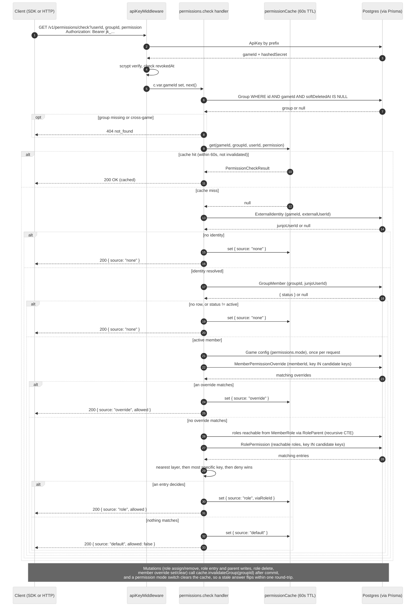

# Permissions

The permissions surface answers a single question: "is this user allowed to do this thing in this group?" Junjo has no opinion about what the permission keys mean: the dev defines them per game (`guild.kick`, `claim_territory`, `edit_treasury`). How keys are matched depends on the game's [permission mode](#permission-modes).

A permission outcome is a function of the member's overrides and the entries on the roles they hold, resolved in layers:

1. **Layer.** The member's own `MemberPermissionOverride` rows first, then the roles the member holds directly, then those roles' parents, then grandparents. A role reachable through several parent paths sits at its shortest distance. The first layer with any matching entry decides.
2. **Context.** Within the deciding layer, an entry limited to the check's [context](#contexts) beats a global one: more matched context keys first, then the nearest inherited value. Checks that send no context see only global entries, so this step changes nothing for them.
3. **Specificity.** Among the entries left, the most specific matching key wins: the exact key, then the longest matching `a.b.*`, down to `*` (wildcards exist only in `"nodes"` mode).
4. **Deny wins** between entries of equal layer, context and specificity.

A role entry carries `value: true` (grant) or `value: false` (deny); see [roles](/api-reference/roles). The route exposes this resolution via `GET /v1/permissions/check`. The result is cached in-process for 60 seconds; mutations that can change a permission outcome invalidate the cache for the affected group on commit (see [Caching](#caching)).

## Resolution flow



The diagram above is committed at `tools/diagrams/source/permission-resolution.mmd`. The committed `.mmd` source and the Mermaid fence above must stay byte-identical.

## Wire format

`PermissionCheckResult`:

| Field | Type | Notes |
|-------|------|-------|
| `allowed` | boolean | True if the user has the permission, false otherwise. |
| `source` | `"role" \| "override" \| "default" \| "none"` | See [Source taxonomy](#source-taxonomy) below. |
| `viaRoleId` | string | Present only when `source === "role"`; the role whose entry decided. When several roles in the deciding layer hold the deciding entry, a denying role is reported over a granting one, then the highest priority, then the highest id. |
| `viaGroupId` | string | Present only on an [inherited check](#inheritance) that reached a decision. It names the group the decision was read from, and equals the queried group when the decision was direct. Absent entirely when `inherit` was not requested, so the non-inherited wire shape is unchanged. |
| `context` | object | The deciding entry's [context](#contexts), with folded values, for example `{ "world": "creative" }`. Omitted when a global entry decided or nothing did. |

### Source taxonomy

| Source | When | Allowed |
|--------|------|---------|
| `none` | The user has no `ExternalIdentity` for this game, has no `GroupMember` row in this group, or is a non-active member (`left`, `kicked`, `invited`). | `false` |
| `default` | The user is an active member and no override or role entry matches this permission. | `false` |
| `role` | An entry on one of the member's roles (held directly or inherited) decided. `viaRoleId` names that role. | the entry's `value` |
| `override` | A `MemberPermissionOverride` for this member matches the key. `allowed` mirrors the deciding override's `grant`. | `override.grant` |

A non-active member short-circuits the resolver to `none` regardless of stored roles or overrides; the lifecycle gate is enforced here, not by mutating role / override rows on transition.

Denies and parent roles only change the answer for roles that use them: a role with only grant entries and no parents grants the keys it lists.

## Permission modes

Each game sets `permissions.mode` in its game config (`PATCH /v1/admin/games/:gameId/config`, admin token). The mode changes only how keys match; the layering above is the same in both.

| | `"exact"` (default) | `"nodes"` |
|---|---|---|
| Key comparison | Verbatim, case-sensitive | Case-insensitive; keys are stored lowercase and checks are lowercased |
| Wildcards | None; `*` is an ordinary character | A trailing `.*` matches one or more further segments; a bare `*` matches every key |
| Key rules on write | 1-128 characters | Also: printable ASCII, no whitespace, no leading `-`, no empty segment (`a..b`, `.a`, `a.`), `*` only as the whole last segment or the whole key |
| Role names | Unique per group | Unique per group ignoring case |

Lowercasing covers ASCII letters only, so every implementation folds keys identically. In `"nodes"` mode, `shop.*` matches `shop.buy` and `shop.buy.bulk` but not `shop` itself.

```json
{ "config": { "permissions": { "mode": "nodes" } } }
```

Switching modes never changes what a stored key means:

- **`exact` to `nodes`** lowercases every stored entry and override key in the same transaction (merging catalog keys that collide). It is refused with `409 permission_mode_conflict` when:
  - any stored key contains `*` or breaks the key rules above;
  - a stored key collides with another key on the same role or member once lowercased;
  - two role names in one group differ only by case.

  The message names the first few offending keys or roles.
- **`nodes` to `exact`** is refused with `409 permission_mode_conflict` while any stored entry or override key contains `*`, since it would stop matching as a wildcard.

A successful switch writes a `game.permissions.mode.set` audit entry (`{ before, after, rewrittenKeys }`) and drops every cached answer.

Checks accept any key in either mode; the rules above apply to writes. Shared test vectors for the resolver live in `packages/shared/conformance/permission-vectors.json` (the format is documented in the `README.md` beside it), and every implementation that resolves locally must pass them.

Context values are folded on write in both modes, so a mode switch never rewrites them. Two keys that collide once lowercased only conflict when they sit on the same role or member **in the same context**.

## Contexts

A role entry or a member override can carry a `context`: a set of conditions under which it applies, such as the world a player is in. An entry without one is global and applies everywhere.

```json
{ "permission": "essentials.fly", "value": true, "context": { "world": "creative" } }
```

A check states its own context (`context.world=creative` on `GET /v1/permissions/check`, or a `context` object per entry on `POST /v1/permissions/check-batch`). An entry with a context **applies** when every one of its keys is in the check's context with a matching value. A check without a context therefore sees only global entries, and gets exactly the answer it got before contexts existed.

### Keys and values

- Keys are game-defined and match `^[a-z][a-z0-9_]{0,31}$`. An entry, an override or a check carries at most 2 keys.
- Values are 1 to 64 characters with no control characters. They are folded with the same ASCII-only lowercase fold as `"nodes"` keys (`A-Z` to `a-z`, nothing else), on write and on check, in **both** permission modes. `World_Nether` and `world_nether` are the same value.
- `{}` and an absent context both mean global.
- An entry's identity is its key **and** its context, so a role can hold `fly` once globally and once per world.

Anything else (an invalid key or value, more than 2 keys, a non-string value, a context query key given twice) is a `400 bad_request`.

### Inheritance between values

A game can declare that one value of a context key inherits another's entries, in its config under `permissions.contexts` (see [admin config](/api-reference/admin#permission-contexts)):

```json
{
  "permissions": {
    "contexts": {
      "world": {
        "inherit": {
          "pvpworld": ["world"],
          "world_nether": ["world"],
          "cave_world_nether": ["world_nether"]
        }
      }
    }
  }
}
```

A check in `pvpworld` then also sees the entries for `world`. Inheritance is transitive and ranked by distance: in `cave_world_nether`, that world's own entries come first (distance 0), then `world_nether`'s (1), then `world`'s (2). Keeping the table in Junjo means every server, the website and the dashboard compute the same answer from one source.

### Precedence

Context sits between layer and key specificity. Inside the deciding layer:

1. **Most matched context keys.** An entry for `{ world, server }` beats one for `{ world }`, which beats a global entry.
2. **Smallest distance sum.** A world's own entry beats one it inherits, and a nearer inherited value beats a farther one.
3. **Key specificity**, among the entries with that same context score.
4. **Deny wins** what is still tied. The reported role follows the usual tie-break (a denying role, then the highest priority, then the highest id).

Layer still comes first: a member's own global override beats any role entry, whatever its context, and a nearer role's global entry beats a parent role's contextual one.

These examples come from a PermissionsEx server's data:

| Setup | Check | Answer | Why |
|-------|-------|--------|-----|
| Role `admin` holds `essentials.fly` deny globally and `essentials.*` grant in `{ world: creative }`. | `essentials.fly` in `creative` | allowed | The contextual entry outranks the global one even though the global key is more specific. In any other world the global deny decides. |
| Role `player` holds `ezauctions.player` grant globally and `ezauctions.player` deny in three worlds. | `ezauctions.player` in one of those worlds | denied | The world entry beats the global one in the same layer. Everywhere else the global grant decides. |
| Role `helper` holds `worldguard.region.bypass.spawn` grant globally and `worldguard.region.bypass.*` deny in `{ world: world }`. | `worldguard.region.bypass.spawn` in `world` | denied | Context ranks above key specificity, so the world-scoped wildcard deny beats the global exact grant. |
| Role `member` (parent `default`) holds `essentials.warp` grant globally; `default` holds `essentials.warp` deny in `{ world: pvpworld }`. | `essentials.warp` in `pvpworld` | allowed | Layer comes first: `member`'s own global grant decides before the parent's world deny is reached. |
| Member override `chat.color` deny, global. Role grants `chat.color` in `{ world: hub }`. | `chat.color` in `hub` | denied | The member layer decides before any role. |

Within one role, PermissionsEx takes the first matching line in file order; Junjo instead ranks by context and then by key specificity, so the answer does not depend on the order entries were written.

## `GET /v1/permissions/check`

Returns the canonical `PermissionCheckResult`. Read-through cache.

### Query parameters

| Field | Required | Notes |
|-------|----------|-------|
| `userId` | yes | The dev's external user id. |
| `groupId` | yes | The group to check against. Must belong to the calling game and not be soft-deleted. |
| `permission` | yes | The permission key. 1-128 characters. |
| `inherit` | no | `"true"` or `"false"` (any other value is a `400`). `"true"` walks the group's ancestors; see [Inheritance](#inheritance). Defaults to false. |
| `context.<key>` | no | The check's [context](#contexts), one parameter per key, for example `context.world=creative`. At most 2 keys; each key at most once. Without any, only global entries apply. |

### Response

`200 OK` with a `PermissionCheckResult` body:

```json
{
  "allowed": true,
  "source": "role",
  "viaRoleId": "role_officer"
}
```

```json
{
  "allowed": false,
  "source": "default"
}
```

`GET /v1/permissions/check?userId=user_alice&groupId=grp_net&permission=essentials.fly&context.world=Creative`:

```json
{
  "allowed": true,
  "source": "role",
  "viaRoleId": "role_admin",
  "context": { "world": "creative" }
}
```

### Errors

| code | status | when |
|------|--------|------|
| `bad_request` | 400 | Missing or empty query params, `permission` is over 128 characters, or a `context.<key>` parameter is invalid or repeated. |
| `not_found` | 404 | Group does not exist in the calling game (cross-game and soft-deleted both collapse here). |
| `invalid_api_key` | 401 | API key missing, malformed, or revoked. |

### Inheritance

This section is about group inheritance (parent groups). Role inheritance (parent roles inside one group) always applies and is part of resolving each group; see [roles](/api-reference/roles#role-parents).

Groups form a parent/child hierarchy (`setParent` / `listChildren`). By default a check ignores it entirely: resolution runs against direct membership in the queried group and nothing else. Pass `inherit=true` to opt into a server-side walk.

The walk visits the queried group first, then its ancestors, nearest first, and **stops at the first group that decides**:

- an `override` at that level, in either direction, decides;
- a `role` entry at that level, grant or deny, decides;
- `none` (not an active member there) and `default` (member, nothing matches) are inconclusive, and the walk continues to the parent.

Each level is resolved with the full layered rules, including role parents and, in `"nodes"` mode, wildcards.

Nearest wins, so a child's explicit deny is **not** undone by a grant further up. If nothing on the chain decides, the queried group's own result is returned unchanged, which preserves the `none` versus `default` distinction that tells "not a member" apart from "member without the grant".

Two boundaries the walk will not cross: a **soft-deleted** ancestor terminates the chain, and an ancestor belonging to a **different game** terminates it too. Depth is bounded by `MAX_PARENT_DEPTH` (100); writes are cycle-checked, so that bound only matters against corrupted state.

The whole chain resolves in one recursive CTE plus one resolution per level, server-side. Each level reads only the overrides and role entries whose keys could match the queried permission, and only the roles reachable from the member's direct roles. That replaces the two HTTP round-trips per level (a `check` and a `groups.get`) that a client-side walker costs.

```json
{
  "allowed": true,
  "source": "role",
  "viaRoleId": "role_admin",
  "viaGroupId": "grp_instance"
}
```

Inherited answers are cached under a separate key from direct ones, and are filed against **every** group on the walked chain, so a grant change at any ancestor drops them.

## `POST /v1/permissions/check-batch`

Resolves many checks in one round-trip. Answers are positional: `results[i]` corresponds to `checks[i]`.

### Body

| Field | Required | Notes |
|-------|----------|-------|
| `checks` | yes | Array of 1 to 100 `{ userId, groupId, permission, context? }` objects. `context` is that entry's [context](#contexts) object; absent or `{}` means only global entries apply. Unknown fields on an entry are a `400`. |
| `inherit` | no | Boolean. Applies to every entry; there is no per-entry flag. |

```json
{
  "checks": [
    { "userId": "user_alice", "groupId": "grp_shop_a", "permission": "shop.view" },
    { "userId": "user_alice", "groupId": "grp_shop_b", "permission": "shop.view" },
    {
      "userId": "user_alice",
      "groupId": "grp_net",
      "permission": "essentials.fly",
      "context": { "world": "creative" }
    }
  ]
}
```

### Response

`200 OK` with `{ "results": [...] }`, each element the same `PermissionCheckResult` the single-check route returns:

```json
{
  "results": [
    { "allowed": true, "source": "role", "viaRoleId": "role_shopper" },
    { "allowed": false, "source": "none" }
  ]
}
```

### Errors

| code | status | when |
|------|--------|------|
| `bad_request` | 400 | `checks` missing, empty, over 100 entries, or an entry is malformed (including an invalid `context`). |
| `not_found` | 404 | Any `groupId` is unknown, soft-deleted, or belongs to another game. The message names the offending entry's index (`group for checks[3] not found`). |
| `invalid_api_key` | 401 | API key missing, malformed, or revoked. |

An unknown group fails the **whole** request rather than resolving that entry as denied, so a typo surfaces instead of silently reading as a denial.

### Cost

A batch is one rate-limited request regardless of how many entries it carries, which is the point: the 100-entry cap is what bounds the server-side work one request can buy. Entries are resolved sequentially, sharing the same identity lookups and the same cache the single-check route uses, so a repeated triple inside a batch costs a map lookup rather than another resolution.

### Caching

The route caches each `(gameId, groupId, userId, permission, context)` answer for 60 seconds (the `PERMISSION_CACHE_TTL_MS` constant in `packages/server/src/permissionCache.ts`). The cache is per-process, in-memory, and unbounded in size; it is not a Redis dependency. `check-batch` shares the same cache, and inherited answers occupy a separate keyspace from direct ones. The context part of the key is the canonical form of the check's folded context, so `context.world=Nether` and `context.world=nether` share an answer while different worlds never do.

The following mutations invalidate the cache for the affected group on commit:

- `POST /v1/groups/:id/members/:userId/roles/:roleId` - role assignment
- `DELETE /v1/groups/:id/members/:userId/roles/:roleId` - role removal
- `POST /v1/groups/:id/members/:userId/permissions/:permission` - override set/update
- `DELETE /v1/groups/:id/members/:userId/permissions/:permission` - override clear
- `POST /v1/roles/:id/permissions` - role entry add or change
- `DELETE /v1/roles/:id/permissions/:permission` - role entry removal
- `PUT /v1/roles/:id/entries` - role entry list replace
- `PUT /v1/roles/:id/parents` - role parents set
- `PATCH /v1/roles/:id` - role update (priority decides which role a result reports)
- `DELETE /v1/roles/:id` - role delete (cascades to MemberRole / RolePermission / RoleParent rows)

The admin equivalents invalidate the same way, and a permission mode switch or a change to `permissions.contexts` clears the whole cache.

A stale cached answer can persist for up to the TTL window if a row is mutated outside the API (e.g. directly via SQL), so prefer the API for any change you need to surface immediately.

### Idempotency

The route has no side effects beyond writing the cache entry. Two consecutive calls with the same params return the same answer. The cache hit / miss is not exposed in the response.
